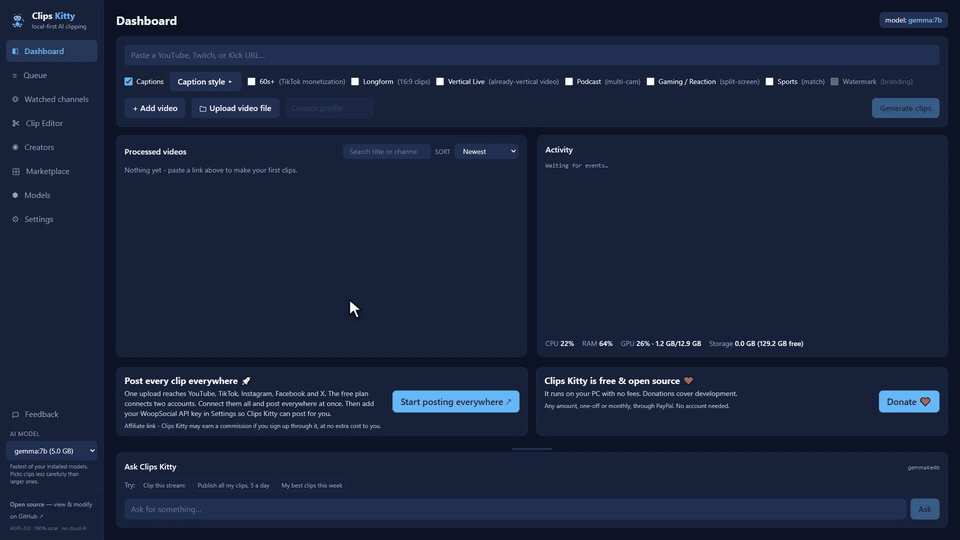

# Grand Theft Auto 6 Clips Kitty Plugin

**Finds the best moments in your GTA 6 (and GTA 5) streams and turns them into
clips** inside [Clips Kitty](https://github.com/ColinGPT9/clips-studio), the free
desktop app that makes vertical clips from stream VODs.



**Version 0.5.3** · plugin ID `colingpt9/gta-vi-highlights` · free and open source (MIT)

## Install

1. Open Clips Kitty and click **Marketplace** in the sidebar.
2. On the **Browse** tab, type `GTA 6` into the search box (or use the
   **Gaming** filter).
3. Find the card **Grand Theft Auto 6 Clips Kitty Plugin**. It shows
   `colingpt9 · 0.5.3` and **✓ Official · made by the Clips Kitty project**.
4. Click **Details**, then **Install**. In the **Install a pipeline** window,
   click **Install** again.
5. When it says **Ready.**, click **Done**.

## Use it

1. On the Dashboard, paste the link to your stream VOD.
2. Tick **Gaming / Reaction**. Clips Kitty finds your webcam and asks you to
   choose a layout (for example **Split**); click **Use this layout**.
3. Under **Gaming detector**, choose **Grand Theft Auto 6 Clips Kitty Plugin**.
4. Click **Generate clips**.

Your clips open in the Clip Editor as usual, marked
*Found by colingpt9/gta-vi-highlights*. Captions, layouts, editing, export and
publishing are all Clips Kitty's own.

> **Uploaded files:** in Clips Kitty 2.1.0, the plugin choice is ignored for a
> video added with **Upload video file**, and a normal Gaming job runs instead.
> The next Clips Kitty update fixes this. Until then, use a VOD link.

## Requirements

- **Clips Kitty 2.1.0 or newer** (Windows, macOS or Linux). No GPU needed.
- **Gaming / Reaction** mode. The plugin replaces the built-in Gaming
  highlight finder; it does not work with Sports or Longform.
- **AI model:** nothing extra. The plugin uses the local AI model you already
  have in Clips Kitty (through Ollama) to double-check its picks and to
  suggest funny dialogue. Nothing new is downloaded. If no local model is
  available, it uses its built-in rules alone.

If your main AI setting uses a cloud provider, you can give this plugin an
Ollama model you already have installed, in the host's `settings.yaml`:

```yaml
plugins:
  local_models:
    colingpt9/gta-vi-highlights: ollama/gemma4:e4b
```

Use your own model name. See the
[local-model guide](https://github.com/ColinGPT9/clips-studio/blob/main/docs/developers/pipeline-development.md).

## What it picks

The plugin reads what you say on stream (the transcript Clips Kitty makes) and
checks it against changes in picture and sound. It picks:

- chases, crashes and spin-outs, stunts and fights
- NPC chaos and your reactions to it
- mission and heist wins, and finished survival runs
- roleplay scenes (traffic stops, arrests and the like)
- funny back-and-forth dialogue, with the setup and the payoff

Each clip keeps the setup before the moment and your reaction after it, and
never cuts off the sentence that proves the moment happened.

## What it skips

- stories about something that happened earlier, plans, "what if" talk and
  take-backs
- thank-yous to donors and subscribers, and routine wave or progress counts
- moments nobody talks about: it cannot see cars, police or faces in the
  picture, so a silent moment is missed
- clips that would end mid-sentence

Scores rank how strong the evidence is. They are not a prediction of views.
On GTA 6 launch-stream segments tested on 2026-11-20 it caught a full
"shoot or don't shoot" moment from setup to payoff, and missed a moment that
played out mostly on screen. Check the clips before you post them.

## Settings

The defaults work without changes. Developers and power users can change them
in the job's pipeline settings:

| Setting | Default | What it does |
|---|---|---|
| `min_score` / `min_confidence` | 42 / 35 | How strong a moment must be (0–100) |
| `max_highlights` | 10 | Most clips per video |
| `lead_in` / `payoff` | 8 / 10 s | Setup and reaction time to keep |
| `enabled_categories` | empty (all) | Only these categories, comma-separated |
| `roleplay_enabled` | true | Include roleplay scenes |
| `use_media` / `use_nominations` | true / true | Use picture and sound changes, and viewer nominations |
| `use_local_model` | true | Use the local AI model |
| `dialogue_review_minutes` | 20 | Most minutes the local AI model spends looking for dialogue (0–20) |
| `trim_to_event` / `title_overlay` | false / false | Suggest trims and a short on-video label |
| `write_report` | true | Save a report explaining each pick |

The full list is in [clipskitty.yaml](clipskitty.yaml).

## For developers

Install a local copy or test a change with the
[Clips Kitty SDK](https://github.com/ColinGPT9/clips-studio/tree/main/sdk/python)
(Python 3.11). Keep the virtual environment outside the plugin folder,
because the app copies that folder when it installs it.

```bash
git clone https://github.com/ColinGPT9/clips-studio.git
git clone https://github.com/ColinGPT9/Grand-Theft-Auto-6-Clips-Kitty-Plugin.git
python3.11 -m venv .venv-gta
source .venv-gta/bin/activate   # Windows: .venv-gta\Scripts\Activate.ps1
python -m pip install -e './clips-studio/sdk/python[yaml,test]'
cd Grand-Theft-Auto-6-Clips-Kitty-Plugin
python -m clipskitty_sdk validate .
python -m pytest
python -m clipskitty_sdk install .   # with Clips Kitty running
```

The plugin only reads the video and its transcript. It has
no network access and sends nothing anywhere; Clips Kitty does all rendering and
publishing. More detail: [evaluation method](docs/EVALUATION.md),
[quality measurements](docs/QUALITY_IMPROVEMENTS.md),
[SDK audit](docs/SDK_AUDIT.md).

## Changes

0.5.3 is the current release. See the [changelog](CHANGELOG.md) for every
version.

## Licence and credits

The plugin's code is [MIT](LICENSE). It is built on the MIT-licensed Clips Kitty
SDK; the scaffold notice is kept in [TEMPLATE-LICENSE.txt](TEMPLATE-LICENSE.txt).
Clips Kitty itself is a separate AGPL-3.0 project. See [NOTICE](NOTICE) and the
[licence inventory](docs/license-audit.md).

This is an unofficial plugin, not affiliated with or endorsed by Rockstar Games
or Take-Two Interactive. Grand Theft Auto is their trademark. The repository
contains no gameplay footage, game assets, logos or model weights.
